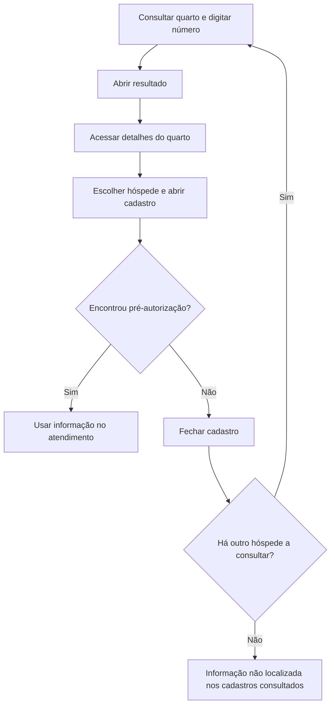
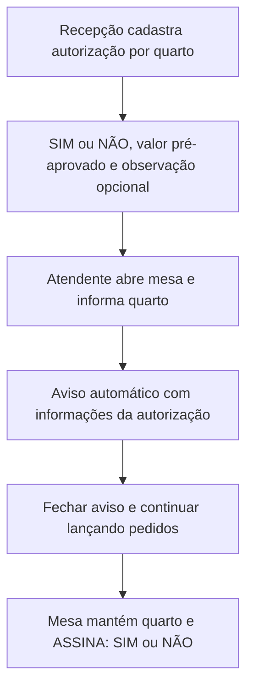
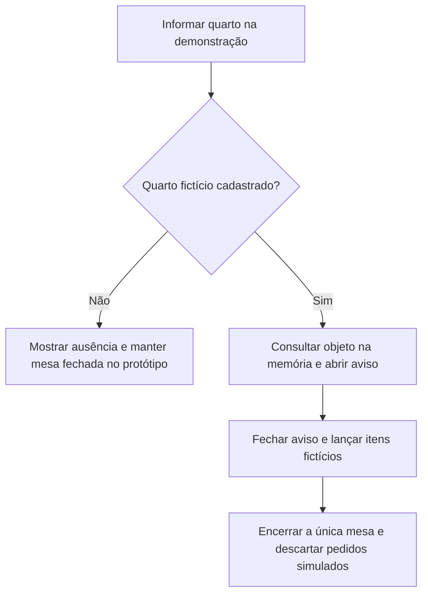
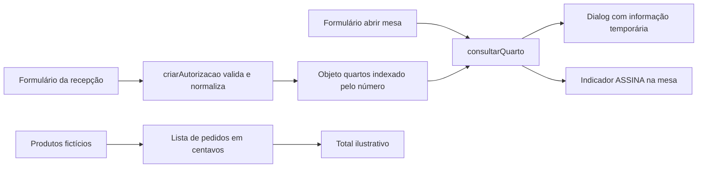

# Fluxos do SmartCheck Hotel

A observação operacional e a solução conceitual são de LeoDevsn. O Codex apoiou sua documentação e criou os fluxos técnicos do protótipo. Os diagramas não reproduzem o sistema real do hotel nem descrevem uma integração implantada. Podem ser renderizados pelo GitHub e por editores compatíveis com Mermaid.

## Processo real relatado pelo autor — AS-IS

Não localizar uma autorização não equivale a uma autorização negada. Carregamentos podem ocorrer nas transições; travamentos reais não são reproduzidos. Para ilustrar esse relato, o Codex escolheu dois cadastros fictícios no quarto 1010. Essa massa de dados não é uma informação real do hotel.

## Solução conceitual definida pelo autor — TO-BE

O fluxo abaixo recorta apenas a consulta de pré-autorização para atendimento vinculado a quarto. Segundo o autor, também é possível abrir mesa sem quarto, como passante ou com pagamento na hora. Essas alternativas não são impedidas pela proposta e não estão representadas no protótipo atual.

Este fluxo contém os requisitos centrais idealizados por LeoDevsn. O tratamento de exceções deve ser avaliado antes de uma eventual implantação.

## Fluxo técnico escolhido pelo Codex para a demonstração

O bloqueio abaixo é uma escolha do protótipo, não um requisito operacional original do autor. O mesmo se aplica à mesa única, reapresentação do aviso, descarte de pedidos e demais limitações registradas no README.

## Circulação dos dados na implementação do Codex

Não existe envio a servidor: ambos os formulários acessam o mesmo objeto na memória da página. Recarregar elimina alterações.
