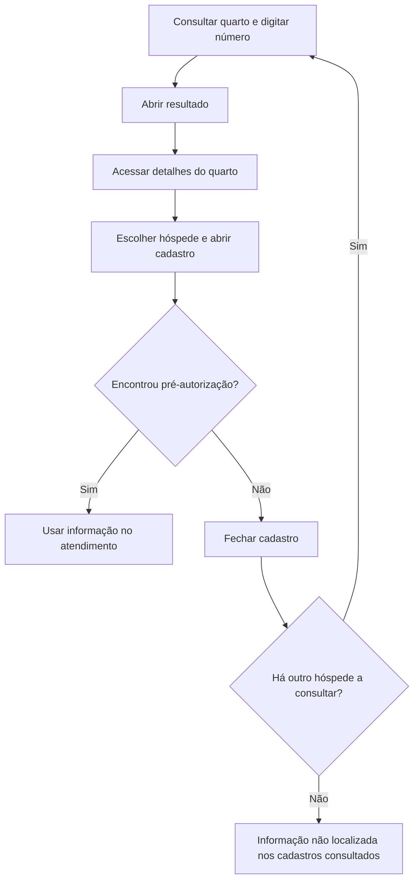
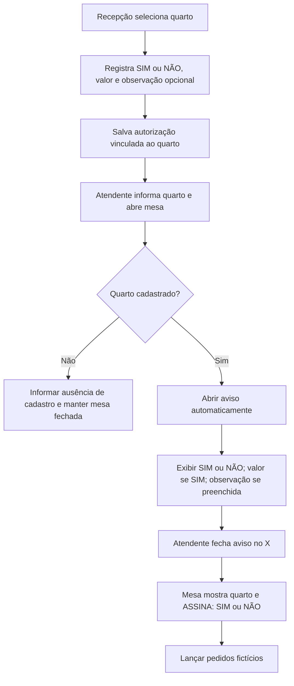
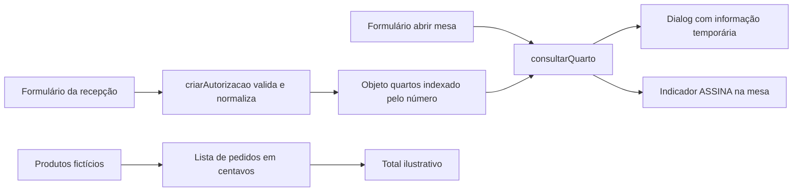

# Fluxos do SmartCheck Hotel

Diagramas conceituais. Não descrevem uma integração implantada. Podem ser renderizados pelo GitHub e por editores compatíveis com Mermaid.

## Processo atual — AS-IS

Não localizar uma autorização não equivale a uma autorização negada. Carregamentos podem ocorrer nas transições; travamentos reais não são reproduzidos. A demonstração fixa dois cadastros fictícios no quarto 1010 para evidenciar a repetição.

## Processo proposto — TO-BE

## Circulação dos dados no código

Não existe envio a servidor: ambos os formulários acessam o mesmo objeto na memória da página. Recarregar elimina alterações.
